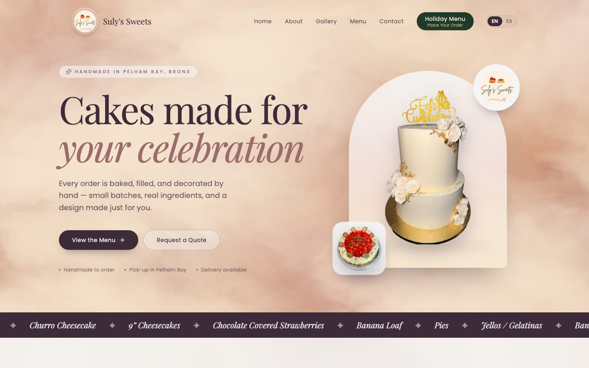
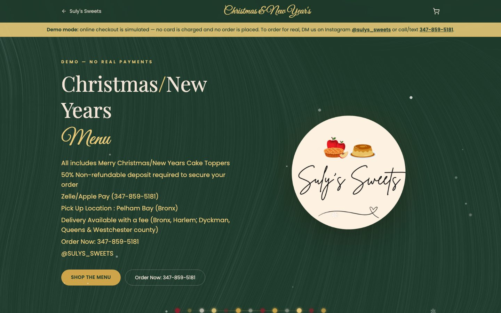
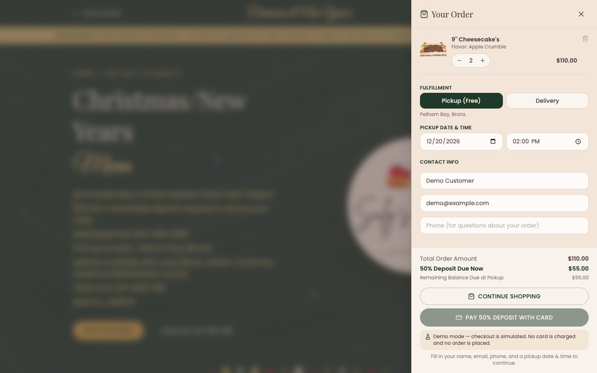
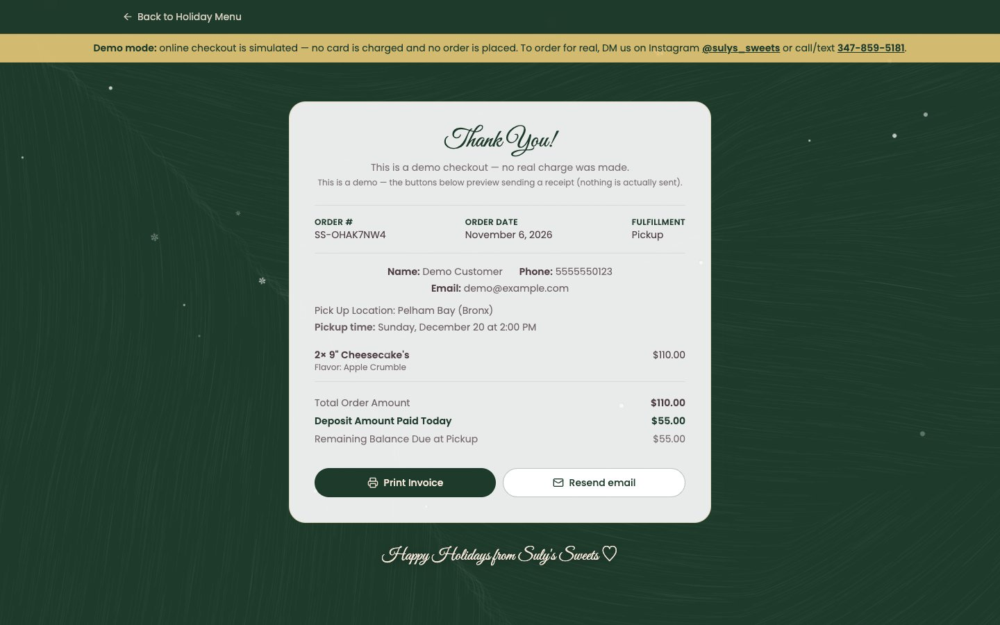
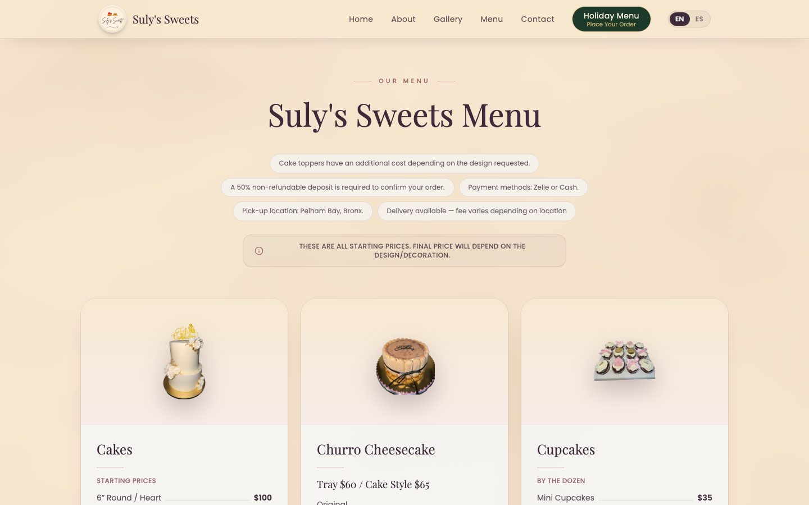
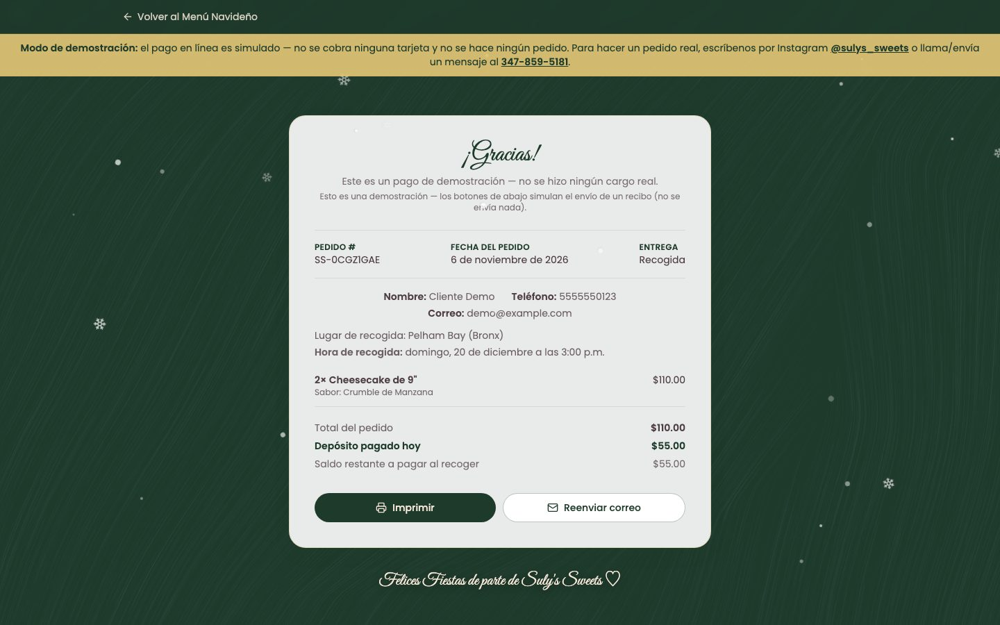
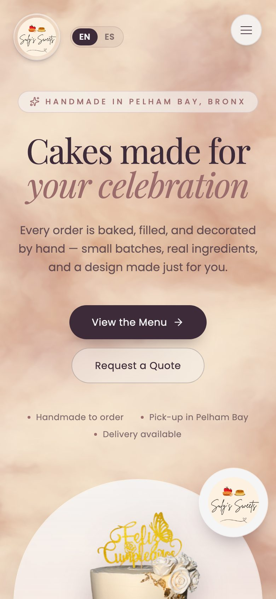
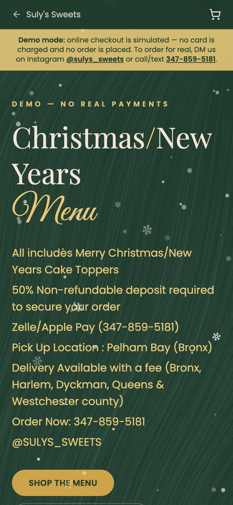

# Suly's Sweets — Bakery Website & Holiday Ordering App

[](https://github.com/WebDesign-MultiMedia/SulysSweets/actions/workflows/ci.yml)

-98-brightgreen)


**Live site:** https://sulys-sweets.vercel.app

A production-style, bilingual (English / Español) website for **Suly's Sweets**, a home bakery in Pelham Bay, Bronx, NY that makes custom cakes, cupcakes, chocolate-covered strawberries and dessert tables. It is a real client project. It has a marketing site and a full **holiday pre-order web app** with a cart, Stripe Checkout (50% deposit), and automatic email receipts.

> **Demo mode:** the live deployment runs without payment or email keys, so nobody can be charged and no real receipts are sent. You can still click through the whole ordering flow; the app detects this and walks you through a realistic demo order instead. Add the keys and the same code runs for real (see [Running it for real](#running-it-for-real)).



## Screenshots

| Holiday menu | Cart & checkout | Order confirmation |
| --- | --- | --- |
|  |  |  |

| Menu | Gallery | Confirmation in Spanish |
| --- | --- | --- |
|  |  |  |

<p align="center">
  
  &nbsp;&nbsp;
  
</p>

---

## What to try (2-minute tour)

1. **Home page** (`/`): animated hero, gallery with a lightbox, the menu with prices, an Instagram section and a contact form.
2. **Language toggle:** switch between English and Spanish (on the home page or the holiday menu). Every page, the cart, product names, errors, legal pages and the order confirmation page are translated.
3. **Holiday menu** (`/holiday-order`): add items to the cart, choose pickup or delivery, pick a date and time, and enter your contact details.
4. **Checkout:** in demo mode you land on the order confirmation page with a sample receipt and a "Resend email" button.
5. **Legal pages:** `/privacy` and `/terms`, in both languages.

---

## Features

### Customer experience
- **Bilingual EN/ES** with a toggle that is remembered across pages. All copy lives in one translation file, and a test fails if any English text is missing its Spanish version.
- **Modern, animated UI:** Vanta.js 3D backgrounds (lazy-loaded), Framer Motion scroll reveals, a scrolling marquee, a holiday theme with snowfall and a garland.
- **Responsive from 360px phones to wide desktops**, with reduced-motion support.
- **Gallery and lightbox** with zoomable product photos.
- **Holiday cart:** quantities, sizes and flavors, pickup or delivery, scheduling, and a running total with the 50% deposit.
- **Order confirmation page** that loads the real order from Stripe and shows receipt status.

### Payments & receipts (serverless backend)
- **Stripe Checkout with server-side price validation:** the server re-prices every cart item from its own price list, so nobody can change prices in the browser.
- **Signature-verified Stripe webhook** sends the receipt once the payment is confirmed.
- **Email receipts** through Resend. Email is the only receipt channel; the phone number is used only to contact the customer about their order.
- **Idempotent, rate-limited resend:** the send count and timestamp are stored on the Stripe session, so webhook retries never send twice. The "Resend email" button is limited to 2 sends per order with a 60-second cooldown, and a send that fails is rolled back.
- **Large-cart support:** order items are split across Stripe's 500-character metadata limit.
- **Safe error handling:** the API returns generic error codes that the browser translates. Details are logged on the server only.
- **Automatic demo mode:** `/api/status` tells the browser whether checkout is live. The demo is used only when checkout isn't set up, never to hide a real error.

### Security & quality
- Security headers set in `vercel.json` (`X-Content-Type-Options`, `X-Frame-Options`, `Referrer-Policy`, `Permissions-Policy`).
- No secrets in the repo; every key is an environment variable (see `.env.example`).
- **51 automated tests** (Vitest) covering pricing, validation, the webhook's single email receipt, receipt rate limiting and rollback, metadata chunking, and translation completeness. Stripe and Resend are mocked, so tests never call real services.
- **GitHub Actions CI** on every push: clean install, syntax check of every API function, tests, production build, and `npm audit` for high-severity issues.
- **Lighthouse:** 100 accessibility, best practices and SEO on mobile and desktop; performance 98 on desktop and about 80 on mobile (see below).

---

## Challenges & decisions

**1. Stopping duplicate and spam receipts**
- *Problem:* Stripe may deliver the same webhook event more than once, and customers can keep pressing "Resend". That could email a customer five times or let someone use the endpoint to spam an inbox.
- *Approach:* receipt state lives on the Stripe session itself. Before a send, the server writes the new count and timestamp (reserving the slot), then sends, and rolls the reservation back if the provider fails. Resends need a paid order and a valid session ID.
- *Result:* at most 2 email sends per order (the automatic one counts), a 60-second cooldown, and a retry after a failure never double-sends. No extra infrastructure was needed.

**2. No database, on purpose**
- *Decision:* the Stripe Checkout session *is* the order record. Items, schedule, contact info, language and receipt state are all stored in its metadata.
- *Trade-off:* orders can't be searched outside the Stripe Dashboard. In exchange there is nothing extra to host, pay for, back up or secure. For a one-person bakery that's the right call. A database can be added later without changing the checkout flow.

**3. Never trusting prices from the browser**
- *Problem:* anything in the cart can be edited in DevTools.
- *Approach:* `/api/checkout` ignores any price the browser sends. It uses only the product IDs, options and quantities, looks up every price in the server's own menu, caps quantities, and rejects unknown products or options before creating the Stripe session.

**4. A demo that never hides real failures**
- *Problem:* the site needs to be a clickable demo without live keys, but an earlier version showed a fake "Thank you!" page whenever checkout failed for *any* reason. A real customer could think they'd ordered when they hadn't.
- *Approach:* `/api/status` reports `live` or `demo`. The browser falls back to the demo only when checkout isn't configured or the API is unreachable. Real errors (bad input, Stripe declining) show a translated error message instead.

**5. Fitting big orders into Stripe metadata**
- *Problem:* Stripe allows only 500 characters per metadata value, so a large cart overflowed and checkout failed.
- *Approach:* the items are serialized and split across `items`, `items_1`, `items_2`, … and reassembled when the order is read back. A size limit returns a clear "cart too large" error instead of a crash.

**6. A $0 bug that the tests caught**
- *Problem:* while writing tests for checkout pricing, a test that sent a made-up size (for example `size: "fake"`) came back priced at **$0**. Next to a real item, that item would have been free.
- *Approach:* `/api/checkout` now rejects any option that isn't on the menu. The test that found it stays in the suite, and it fails against the old code.

**7. Making the phone version fast**
- *Problem:* Lighthouse mobile scored 71, with the main content taking about 10 seconds to appear on a simulated phone connection. The page was downloading about 5 MB of images up front: a 941 KB logo shown at 40 px, and every cake photo, including ones in sections hidden on phones (browsers still fetch lazy images inside hidden sections).
- *Approach:* phone sections are only put on the page once visited; the About slideshow keeps 3 slides on the page instead of 11; logos are resized (941 KB → 32 KB) and the hero photos converted to WebP (319 KB → 40 KB); the three.js background starts after the page has loaded; and the hero uses a CSS entrance animation so it paints on the first frame instead of waiting for JavaScript.
- *Result:* mobile performance went from about 71 to about 80–85, and the first load on phones fetches 3 images instead of about 14. Accessibility went from 95 to 100 after raising footer text contrast and fixing the language toggle's accessible name.

---

## Lighthouse scores

Measured on the live site with Lighthouse 12 (home page). Mobile numbers vary a few points between runs.

| | Performance | Accessibility | Best practices | SEO |
| --- | --- | --- | --- | --- |
| Desktop | 98 | 100 | 100 | 100 |
| Mobile (simulated slow 4G) | ~80 (78–85) | 100 | 100 | 100 |

What still limits mobile performance: the site is a single-page React app, so content appears only after the JavaScript loads, and the remaining cake photos are large PNGs. Pre-rendering the home page and converting the rest of the photos to WebP would be the next steps.

## Tests

```bash
npm test
```

| File | What it checks |
| --- | --- |
| `tests/checkout.test.js` | Server-side pricing, 50% deposit, ignoring browser prices, quantity cap, unknown products and options, input validation, demo-mode response, extra fields from old clients ignored, language stored |
| `tests/resendReceipt.test.js` | Email resend: unpaid orders, 2-send limit, 60-second cooldown (and resend after it), reserve-then-send, rollback on provider failure |
| `tests/webhook.test.js` | Exactly one email receipt per paid checkout, no resend on Stripe retries, unpaid sessions and bad signatures send nothing, the email sender is the only receipt channel |
| `tests/stripeOrder.test.js` | Splitting items across 500-character metadata values and reading them back, session ID validation, order language |
| `tests/i18n.test.js` | English and Spanish have the same keys, every product has a Spanish name, Spanish date formatting |

---

## Tech stack

| Area | Tools |
| --- | --- |
| Frontend | React 18, Vite 6, React Router 7 |
| Styling | Tailwind CSS v4 (design tokens via `@theme`) |
| Animation & visuals | Framer Motion, Vanta.js (Three.js / p5.js), Lucide icons |
| Backend | Vercel Serverless Functions (Node.js, `/api`) |
| Payments | Stripe Checkout + webhooks (`stripe`, `@stripe/stripe-js`) |
| Email | Resend |
| i18n | Custom React context + translation dictionary (EN/ES) |
| Testing | Vitest (with mocked Stripe and Resend), Lighthouse |
| Hosting & CI/CD | Vercel (auto-deploys from `main`), GitHub Actions |

---

## Architecture

```
Browser (React SPA)
 ├─ /               Home: hero, about, gallery, menu, Instagram, contact
 ├─ /holiday-order  Holiday menu + cart drawer ──► POST /api/checkout ──► Stripe Checkout
 ├─ /holiday-order/success?session_id=…  ◄── GET /api/order (reads the Stripe session)
 └─ /privacy, /terms

Stripe ──(checkout.session.completed)──► POST /api/webhook
                                           └─ email receipt (Resend, sent once per order)

POST /api/send-email   customer-triggered email resend (rate-limited)
GET  /api/status       { checkout: "live" | "demo" }
```

There is no database. **The Stripe Checkout session is the order record**: items, contact info, schedule, language and receipt state all live in its metadata. That keeps the app cheap and simple to run for a small business.

### Project structure

```
api/                 Serverless functions (each file is an endpoint)
  _lib/              Shared helpers (not routes): Stripe order encoding,
                     receipt rate limiting, email sender
src/
  components/        Home page sections and shared UI
  components/holiday/  Holiday ordering UI (cart drawer, product cards, snow)
  pages/             Route pages (Home, HolidayOrder, Success, Privacy, Terms)
  context/           Holiday cart state
  hooks/             useCheckoutMode, useMatchMedia, useBodyBackground
  i18n/              Language context + all EN/ES translations
  data/              Menu, holiday products, gallery, demo order
public/              Images and logo
tests/               Vitest test suite
.github/workflows/   CI pipeline
```

---

## Running locally

```bash
npm install
npm run dev        # front end at http://localhost:5173 (checkout falls back to demo mode)
npm run build      # production build
npm test           # run the test suite
```

To run the `/api` functions locally as well, use the Vercel CLI:

```bash
npm i -g vercel
cp .env.example .env.local   # fill in test keys
vercel dev
```

## Running it for real

Set these environment variables in Vercel (names only; see `.env.example`):

| Variable | Purpose |
| --- | --- |
| `STRIPE_SECRET_KEY` | Creates Checkout sessions; switches off demo mode |
| `STRIPE_WEBHOOK_SECRET` | Verifies `/api/webhook` events |
| `RESEND_API_KEY`, `RESEND_FROM_EMAIL` | Email receipts |

Use Stripe **test mode** keys first. Test card: `4242 4242 4242 4242`, any future date, any CVC.

---

## About

Designed and built by **WebDesign-MultiMedia** for Suly's Sweets.
Business: [@sulys_sweets on Instagram](https://www.instagram.com/sulys_sweets) · sulyssweets24@gmail.com · 347-859-5181
